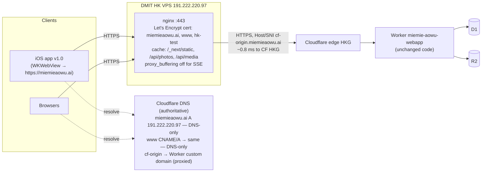

# Zero-update routing of existing iOS users to Hong Kong (DMIT)

Investigation date: 2026-10-10 (PDT). All production checks were read-only.
Legend: **[V]** verified fact · **[A]** assumption / inferred · **[R]** recommendation.

---

## 1. Executive summary and verdict

**Feasible without an App Store update — but only by keeping the exact hostname `miemieaowu.ai` and changing where its DNS points.**

- [V] The shipped iOS app (App Store v1.0, released 2026-04-20, live in the US, CN and HK stores) is a thin Capacitor shell that loads the live site `https://miemieaowu.ai` in a WKWebView. Every page, API call, image and video is fetched over the network with **relative URLs**, so all traffic follows whatever `miemieaowu.ai` resolves to.
- [V] From the DMIT VPS, Cloudflare's **Hong Kong PoP is 0.8 ms away**. The slow part for China Unicom users is the client → Cloudflare-edge path, not Cloudflare → origin.
- [R] **Simplest safe design: put DMIT in front of the existing Cloudflare deployment, not instead of it.** DMIT terminates TLS for `miemieaowu.ai` with a public Let's Encrypt certificate and reverse-proxies to the existing Worker in Cloudflare's HKG PoP over a new proxied hostname (`cf-origin.miemieaowu.ai`). There is no data migration and there is a single database (D1). Rollback is a DNS change. Static/immutable assets can be cached on DMIT.
- [V] Cloudflare's proxied Load Balancer **does not help**, because traffic would still enter at a Cloudflare edge. Cloudflare DNS cannot do China-Unicom-specific steering. A per-ISP split would require moving authoritative DNS to a China-aware provider (DNSPod / Alibaba DNS), which is high-complexity and not needed for a first step.
- [R] First cutover: **all users → DMIT via DNS-only records**, after shadow validation, including a test of the real installed app using a DNS override on a test iPhone. Overseas users get one extra hop (HK → Cloudflare HKG), which is acceptable for this app's audience. Geo/ISP splitting is optional later.

---

## 2. Verified architecture of the distributed iOS app

| Question | Finding | Evidence |
|---|---|---|
| Remote `server.url` or bundled HTML? | **Remote.** Release builds use `server.url = "https://miemieaowu.ai"`. Only dev builds use localhost. There is no static export: `webDir: "out"` is a placeholder. | [V] `capacitor.config.ts:3,8-19`. The config was last changed 2026-04-16 (`768707a`), before the v1.0 release on 2026-04-20 (iTunes lookup API). |
| Effective WebView origin | `https://miemieaowu.ai` | [V] `capacitor.config.ts:17`. [A] Shipped `capacitor.config.json` is not in git (`ios/.gitignore:12`) and no IPA/archive exists on this machine, so the shipped file is inferred. See unknown U1. |
| Endpoints called | Same origin only: `/api/*`, pages, `/api/photos/*`, `/api/media/*.mp4`, `/_next/static/*`. Third-party calls (OpenRouter, Serper, Amap, Kalshi, ESPN) are **server-side** in the Worker. `maps.apple.com` is only an outbound link. | [V] `grep` of `src/`: every client `fetch` starts with `/api/` (e.g. `src/app/lists/[id]/page.tsx:51,56,81`). |
| Absolute / relative / env-dependent | Relative. No build-time API base URL. | [V] same grep. No `NEXT_PUBLIC_*` API host. |
| Hostnames hardcoded in the iOS binary | `miemieaowu.ai` (server.url) and `applinks:miemieaowu.ai`. Bundle ID `ai.miemieaowu.list`, team `49WZT4HS2Y`. | [V] `capacitor.config.ts:17`, `ios/App/App/App.entitlements:7`, `ios/App/App.xcodeproj/project.pbxproj:301,312` |
| Native HTTP plugin or WebView fetch | WebView `fetch`. `CapacitorHttp` is not enabled, and there is no custom native networking. | [V] `capacitor.config.ts` (no `CapacitorHttp`), `ios/App/App/AppDelegate.swift` (template only) |
| App Transport Security | Default ATS: HTTPS with a publicly trusted cert, TLS 1.2+, forward secrecy. No exceptions. | [V] `ios/App/App/Info.plist` has no `NSAppTransportSecurity` key |
| Long-lived connections | No WebSockets. One **SSE-style stream** (`text/event-stream`) for bulk import progress. | [V] `src/app/api/lists/[id]/items/bulk/route.ts:165`, `src/components/BulkImportModal.tsx:141` |
| Bundled vs fetched resources | Only the native shell, icons and launch screen are bundled. All HTML/JS/CSS/media comes from `miemieaowu.ai`. | [V] `ios/.gitignore:4` (`App/App/public` generated). Remote server.url. |
| Cloudflare-specific dependencies | Server-side only: D1, R2 and ASSETS bindings in the Worker. **No client-visible dependency**: no `cf-*` headers, no client IP or geo logic. Locale comes from `Accept-Language`. | [V] `wrangler.toml:6-9,11-23`. `git grep` for `cf-connecting-ip`/`x-forwarded-for`/`request.cf` found nothing. `src/lib/i18n.ts:5-6` |
| Auth / session | HttpOnly cookie `token`, host-only (no `Domain`), `SameSite=Lax`, `Secure` in prod, 1-year TTL. It's an HMAC JWT signed with `JWT_SECRET`. | [V] `src/lib/auth.ts:3-4,84-92` |
| Universal Links | `applinks:miemieaowu.ai`. AASA served at `/.well-known/apple-app-site-association` and already cached by Apple's CDN. | [V] `src/app/.well-known/apple-app-site-association/route.ts:10-11`. Live fetch returned 200 from both origin and `app-site-association.cdn-apple.com`. |
| Redirects | Relative (`location: /login`), so they're host-agnostic. | [V] `curl -I https://miemieaowu.ai/lists` returned `307 location: /login` |

**Implication [V]:** native code changes (e.g. the Badge plugin added 2026-05-11, `84ebbd6`) never reached v1.0 users, but **web changes reach them instantly**. Any routing that keeps `https://miemieaowu.ai` working with a valid certificate is invisible to the shipped app.

---

## 3. Network endpoint inventory

| Hostname | Purpose | Example path | Configured in | In shipped iOS app? | DNS-only switch redirects it? | DMIT supports today? | Risks / requirements |
|---|---|---|---|---|---|---|---|
| `miemieaowu.ai` | WebView origin, pages, API, auth, photos, videos, AASA | `/lists/<id>`, `/api/lists/<id>`, `/api/photos/<key>`, `/api/media/qingge.mp4`, `/.well-known/apple-app-site-association` | `capacitor.config.ts:17`, `wrangler.toml:7`, Cloudflare DNS (apex, proxied, Worker custom domain) | **Yes** (server.url and associated domain) | **Yes**, once the Worker custom domain is detached and a DNS-only A record is created | **No.** DMIT serves only `/__benchmark/*` and `/healthz` over HTTP:80 | Needs a publicly trusted cert on DMIT; the AASA must keep returning 200 JSON with no redirect; SSE must not be buffered |
| `www.miemieaowu.ai` | Alias | `/` | `wrangler.toml:8`, Cloudflare DNS | No (not in app) | Yes | No | Same as above; keep redirecting or serving |
| `cf-origin.miemieaowu.ai` *(proposed)* | Proxied hostname for the Worker, used by DMIT as upstream | all paths | New Worker custom domain (approval needed) | No | N/A (stays proxied) | N/A | Must not be advertised; optionally lock to DMIT's IP with a WAF rule |
| `hk-test.miemieaowu.ai` *(planned)* | Shadow validation in a browser | all paths | New DNS-only A record → `191.222.220.97` (approval needed) | No | Yes | No (no app, no TLS yet) | Cookies are host-only, so a separate login is needed (expected) |
| `/_next/static/*` (same origin) | JS/CSS chunks | `/_next/static/chunks/*.js` | Next build | Fetched at runtime | Follows the origin | No | Immutable, so safe to cache on DMIT |
| `app-site-association.cdn-apple.com` | Apple's AASA cache | `/a/v1/miemieaowu.ai` | Apple | Used by iOS | N/A | N/A | Apple re-fetches the AASA from our origin periodically, so DMIT must serve it correctly |
| `openrouter.ai`, `google.serper.dev`, `restapi.amap.com`, ESPN, Kalshi | Server-side third-party APIs | — | `src/lib/llm.ts:16`, `src/lib/serp.ts:17`, API routes | No (server-side) | N/A | N/A | Unaffected while the Worker remains the backend |
| `maps.apple.com` | Outbound link only | — | `src/app/wheel/page.tsx:752` | Opened externally | N/A | N/A | None |

**Check of `/lists/9bc3ed04-6f1e-4228-b5a0-9e5151c2feb5` [V]:**
- The page is a client component. It calls `/api/lists/<id>`, `/api/auth/me` and `/api/lists/<id>/comments`, plus `/api/photos/*` for images (`src/app/lists/[id]/page.tsx:51,56,81`). Anonymous `GET /api/lists/<id>` returns 200 (the list is public).
- **Via the DMIT-proxy design:** all of these work, because every path is forwarded to the same Worker.
- **Via a standalone DMIT app** (the `hk-hosting` branch port): it would work only after the D1 and R2 data is copied, and from then on D1 would no longer be authoritative.
- **Today:** DMIT cannot serve it.

---

## 4. Routing options compared

| | A. CF proxied Load Balancer → DMIT | B. CF DNS-only → DMIT | C. Geo DNS (CN → DMIT, rest → CF) | D. ISP DNS (Unicom → DMIT) | E. DMIT reverse proxy in front of CF Worker (same hostname) | F. Standalone app on DMIT (`hk-hosting` branch) |
|---|---|---|---|---|---|---|
| iOS update needed? | No | No | No | No | No | No |
| Keeps exact hostname? | Yes | Yes | Yes | Yes | Yes | Yes |
| Traverses CF reverse proxy? | **Yes, client → CF edge** | No | CN: no · rest: yes | Unicom: no · rest: yes | Client → DMIT, then DMIT → CF HKG (0.8 ms) | No |
| Bypasses Unicom → CF edge path? | **No**, so it doesn't fix the measured problem | Yes | Yes for CN resolvers | Yes for Unicom resolvers | Yes | Yes |
| Fits Workers + Pages as-is | Origin must be DMIT, so the Worker isn't used | Worker must become DMIT's upstream (=E) or be replaced (=F) | A hostname can't be both proxied and DNS-only by geo inside Cloudflare; it needs DNS outside CF plus CF partial/SaaS setup | Same as C, plus an ISP-line DNS provider | **Yes**: Worker unchanged; add the `cf-origin` custom domain | Replaces Worker, D1 and R2 |
| Country/ISP steering support | N/A | None (everyone) | CF LB geo steering exists but only returns *IP endpoints* in DNS-only mode, so it can't hand back a Worker. Needs an external DNS provider | Cloudflare: **no ISP steering**. DNSPod/Alibaba DNS: yes (ISP "lines") | Combine with B (everyone) or C/D later | Combine with B |
| TLS | CF edge cert | DMIT needs a public cert (LE via DNS-01) | Both ends need valid certs for the same name | Same | DMIT: LE cert for `miemieaowu.ai`. Upstream: CF edge cert for `cf-origin` | DMIT: LE cert |
| Cookies / auth | Unchanged | Unchanged if backend shared | **Two backends = two databases unless both reach the same backend** | Same | Unchanged: host-only cookie passes through; same `JWT_SECRET` and D1 | Same `JWT_SECRET` needed; sessions survive if the DB is migrated |
| CORS / origin | Same origin | Same origin | Same origin | Same origin | Same origin. Upstream Host differs, but redirects are relative ([V]) | Same origin |
| Caching / static | CF cache | Lost unless DMIT caches | Mixed | Mixed | DMIT caches immutable assets (`/_next/static`, `/api/photos`, `/api/media`) | Served locally |
| Reliability / fallback | CF LB health checks | Single VPS, manual DNS rollback | Single VPS for CN | Single VPS for Unicom | Single VPS; if CF is down, DMIT is down too | Single VPS plus a self-run DB |
| Ops complexity | Low | Low | High | High | **Low–medium** (nginx + certbot) | High (DB, backups, Node, migrations) |
| Approx. cost | LB from ~$5/mo (verify) | $0 extra | DNS provider plus possibly CF Business ($200/mo) for partial setup | Same as C | $0 extra (VPS already paid) | $0 extra; most ops time |
| Rollback | Toggle LB | Re-attach Worker custom domain (DNS TTL) | Change DNS lines | Change DNS lines | Re-attach Worker custom domain to apex/www (DNS TTL) | Hard: data written on DMIT must be copied back to D1 |

**Why E beats F for the first step:** it gets nearly all of the China network gain (the bad hop is client → edge) with no data migration and a trivial rollback. F (moving the backend itself) only removes the remaining Worker → D1 latency (0.2–0.6s measured from HK, [V]). That can be a later, separate project.

---

## 5. Recommended architecture

Rollback path: re-attach the Worker custom domain to `miemieaowu.ai`/`www`. Clients then go straight to Cloudflare as today.

---

## 6. Domain and DNS requirements

[V] The zone `miemieaowu.ai` is on Cloudflare (NS `etienne`/`stevie.ns.cloudflare.com`). The production hostname is the **zone apex**. Apex and `www` are Worker **custom domains** (`wrangler.toml:6-9`); Cloudflare auto-creates proxied records for them (they currently resolve to `104.21.27.233` / `172.67.143.170` plus IPv6, including from China resolvers 223.5.5.5, 119.29.29.29 and 114.114.114.114). There are no CAA records, so Let's Encrypt is allowed. `hk-test` does not exist yet.

| Change | When | Approval |
|---|---|---|
| Add Worker custom domain `cf-origin.miemieaowu.ai` | Shadow phase | Required |
| Add `hk-test.miemieaowu.ai` A `191.222.220.97`, **DNS-only**, TTL 60 | Shadow phase | Required |
| Create a Cloudflare API token scoped to *Zone:DNS:Edit* on this zone, for certbot DNS-01 (`_acme-challenge` TXT only) | Shadow phase | Required |
| Cutover: detach Worker custom domains from `miemieaowu.ai` and `www`, then create A `191.222.220.97` **DNS-only** TTL 60 for both. No AAAA unless DMIT IPv6 is configured. | Cutover | Required |
| Rollback: delete those A records and re-attach the custom domains | If needed | Pre-approved runbook recommended |

[A] Detaching a custom domain and creating the replacement record are separate steps, so expect a gap of up to a minute where the name doesn't resolve. Do it at a low-traffic time.

---

## 7. Cloudflare-specific constraints

- [V] A Worker custom domain owns its DNS record. You cannot make `miemieaowu.ai` DNS-only while the custom domain is attached.
- [V] Proxied (orange-cloud) records and proxied Load Balancers always send clients to a Cloudflare edge first. That is the path that fails for Unicom, so **A is ruled out**.
- [A] Cloudflare's authoritative DNS doesn't use ECS from public resolvers, so geo steering keys on the resolver's location. Users on 8.8.8.8/1.1.1.1 or iCloud Private Relay would be misclassified. No ISP steering is offered.
- [A] Serving a hostname via Cloudflare while its DNS lives elsewhere (needed for C/D) requires a CNAME/partial setup (Business+) or Cloudflare for SaaS.
- [R] With E, all China traffic reaches the Worker from one IP (DMIT). Add a WAF/rate-limit **skip** rule for `191.222.220.97` so bot rules don't challenge it, and consider only allowing `cf-origin` traffic from that IP.
- [V] The Worker sees the DMIT IP as the client. The app uses no client-IP logic, so nothing breaks.

---

## 8. TLS, auth and compatibility risks

| Risk | Detail | Mitigation |
|---|---|---|
| Certificate trust | iOS ATS needs a publicly trusted cert. **Cloudflare Origin CA is not trusted by iOS**, so it can't be used on DMIT. | [R] Let's Encrypt via **DNS-01** (works before DNS points at DMIT, and keeps renewing during rollback). Monitor expiry. |
| AASA / Universal Links | Apple re-fetches the AASA via its CDN. A broken AASA would break universal links for new installs. | Proxy passes it through. Verify 200 `application/json` with no redirect before cutover. |
| SSE buffering | nginx buffers responses by default, which would freeze the bulk-import progress stream. | `proxy_buffering off` (or the Worker sending `X-Accel-Buffering: no`). Test bulk import. |
| Upload size | Photo uploads go through nginx. | `client_max_body_size 25m` |
| Host header | Upstream Host is `cf-origin.miemieaowu.ai`. Redirects are relative ([V]) and cookies are host-only, so both are fine. | Add `proxy_redirect` rewriting `https://cf-origin.miemieaowu.ai/` → `/` as a safety net. |
| Video range requests | `/api/media/*` relies on Range/206. | Pass `Range` through; cache only full 200 objects or use slice caching. |
| Capacity: 1 vCPU, 1 GB RAM, 20 GB SSD | nginx proxying is lightweight. | [A] Fine for this app's scale. Confirm with Cloudflare analytics (unknown U3). |
| Bandwidth: 500 GB/month, bidirectional | A proxied response counts twice (CF→DMIT plus DMIT→client). | Cache immutable assets and videos on DMIT. Watch DMIT's usage meter. |
| Single point of failure | If the VPS or DMIT's Eyeball (Beta) routing goes down, everyone is down after cutover. | External uptime monitor on `/healthz` and a page; documented 5-minute rollback; low TTL. |
| DNS caching on rollback | Some China ISP resolvers ignore low TTLs, and iOS keeps connections alive. | Lower TTL a day ahead. Expect a rollback tail of minutes to an hour. |
| Plain-HTTP benchmark on :80 | Currently public. | Keep it, or restrict it after the experiment. Don't serve app traffic over :80 except a redirect to HTTPS. |

---

## 9. Migration and rollback plan

1. **Shadow build (DMIT only, no production impact)** — needs approval for the three Cloudflare changes in §6.
   1. Add the `cf-origin.miemieaowu.ai` custom domain to the Worker. Verify `https://cf-origin.miemieaowu.ai/login` returns 200.
   2. Add `hk-test` DNS-only. Get the LE cert via certbot plus the Cloudflare DNS-01 plugin for `miemieaowu.ai`, `www.miemieaowu.ai` and `hk-test.miemieaowu.ai`.
   3. Configure an nginx `:443` server for those names: `proxy_pass https://cf-origin.miemieaowu.ai`, `proxy_ssl_server_name on`, `proxy_set_header Host cf-origin.miemieaowu.ai`, `proxy_buffering off` (SSE), `client_max_body_size 25m`, and a disk cache for `/_next/static/`, `/api/photos/` and `/api/media/`. Keep the benchmark server block as is.
2. **Validate on the temporary hostname:** in a browser at `https://hk-test.miemieaowu.ai`, test login, lists, the test list `/lists/9bc3ed04-…`, photo upload, comments, bulk import (SSE), video seeking and the wheel/LLM features.
3. **Validate the real hostname without touching public DNS:**
   - From the Mac: `curl --resolve miemieaowu.ai:443:191.222.220.97 https://miemieaowu.ai/...` for pages, API and the AASA.
   - **Test the installed App Store app:** point a test iPhone's Wi-Fi DNS at a resolver that overrides `miemieaowu.ai → 191.222.220.97` (e.g. dnsmasq on the Mac, or a NextDNS rewrite). Open the app and confirm requests appear in the DMIT access log. This is the definitive "no app update needed" proof.
4. **Monitoring and rollback prep:**
   - Uptime checks on `https://miemieaowu.ai/healthz` (served by DMIT) and `/login`.
   - Track nginx error rate and 5xx counts, plus DMIT bandwidth.
   - Lower TTLs.
   - Write the rollback runbook: delete the A records, re-attach the custom domains, verify `cf-ray` returns.
5. **Limited cutover:** there's no safe percentage split with DNS-only records for one hostname, so "limited" here means time-boxed. Switch apex and `www` at a low-traffic hour, watch for 1–2 hours, and roll back on any regression. Optionally run ITDOG HTTP and ping against `miemieaowu.ai` before and after.
6. **Expand / harden:** if stable for a week, decide on:
   - (a) staying on E,
   - (b) geo or ISP split via an external DNS provider (C/D), or
   - (c) moving the backend to HK (`hk-hosting` branch) to cut the Worker → D1 latency.

**Rollback (any stage):** re-attach the Worker custom domains to `miemieaowu.ai`/`www`. That restores today's exact behaviour, and no data reconciliation is needed because D1 stayed authoritative throughout.

---

## 10. Unknowns and decisions for you

| # | Unknown / decision | Why it matters | How to resolve |
|---|---|---|---|
| U1 | The exact `capacitor.config.json` inside the shipped v1.0 IPA | Confirms server.url = `https://miemieaowu.ai` (inferred from source dated before release) | Download the IPA with Apple Configurator and read `Payload/App.app/capacitor.config.json`, or do the DNS-override test in step 3 |
| U2 | Whether any TestFlight / enterprise builds with other configs exist | Other builds may point elsewhere | Check App Store Connect |
| U3 | Traffic volume (requests/day, GB/month, peak) | DMIT capacity and the 500 GB cap | Cloudflare dashboard → Workers → Analytics (read-only), or share a screenshot |
| U4 | Share of users outside mainland China | Decides whether "all users → DMIT" is acceptable or C/D is worth the complexity | Analytics by country |
| D1 | Approve the three shadow-phase Cloudflare changes (§6) | Needed to build and validate the shadow | Your approval |
| D2 | Approve the cutover window and rollback owner | Production change | Your approval |
| D3 | Option E now, F (backend in HK) later? | Scope | Your call; E is recommended first |
| D4 | DMIT "Eyeball (Beta)" reliability is acceptable for production | Beta routing could change | Run uptime monitoring for 1–2 weeks during the shadow phase |
