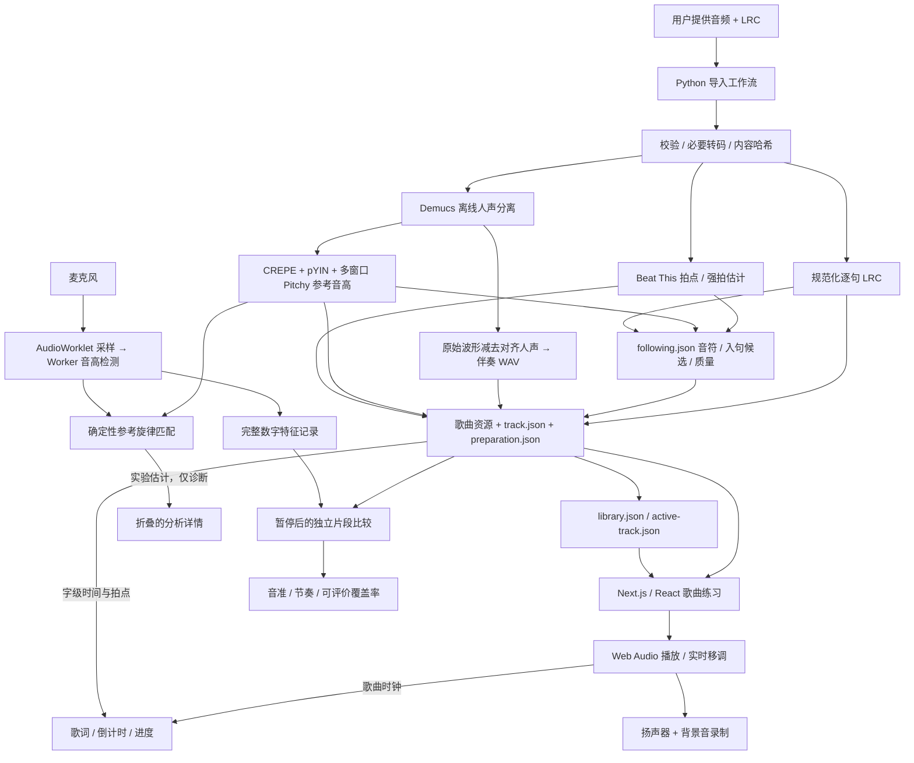
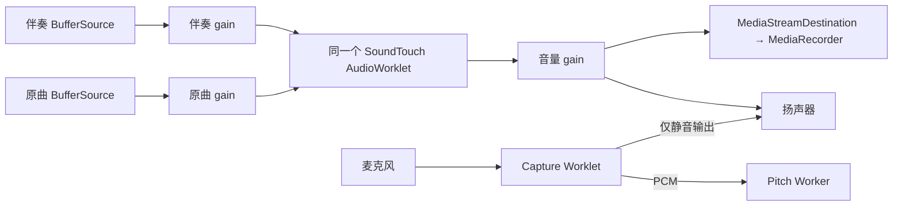
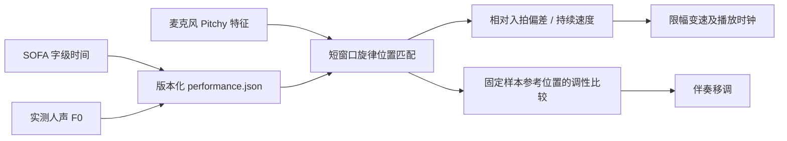

# Cadence：系统架构

更新：2026-10-18。本文描述当前代码已实现的架构；备选方案和后续方向见 [技术决策与取舍](technical-decisions.md)。操作步骤见 [歌曲预处理](song-preparation.md)。模型、研究论文、官方实现与采用状态见 [参考资料索引](technical-decisions.md#references)。

## 1. 产品范围与核心约束

当前主要体验是**固定伴奏的练唱与反馈**：使用离线字级歌词、参考音高和拍点指导演唱，暂停／结束后汇总本次数字特征。伴奏保持用户手动设定的调性与速度；麦克风开关独立，不再自动移调或调速。音乐拥有独立时间线，用户换气、停唱或拒绝麦克风权限都不影响播放。2026-10-18 的产品行为以第 15 节为准；第 14 节及 D22–D26 保留历史跟随实验。

项目保留两条不同的执行路径：

| 入口 | 音乐来源 | 可调整内容 | 依赖 |
| --- | --- | --- | --- |
| `/` 录音歌曲练习 | 导入的原曲、AI 分离伴奏 | 背景音 ±6 半音、手动 0.5×–1.5× 变速、音量、原曲/伴奏切换 | 浏览器 + 已准备好的本地资源 |
| `/acoustic` 合成乐队实验 | 人工整理的旋律/和弦谱、程序合成音色 | 编配、音量、受限的节奏适应等 | 浏览器；可选 Python 策略服务 |

主页面不生成新的乐曲编配、不自动识别绝对调名、不修正麦克风人声，练唱模式没有自动变速／移调，不支持自动段落跳转（详见技术决策 D22、D23）。`/acoustic` 的详细设计保留在 [合成乐队架构](acoustic-architecture.md)。

## 2. 整体数据流



模型推理在导入阶段完成。录音歌曲运行时的检测、判断和音频处理都在浏览器内执行，没有实时模型 API 调用。Next.js 提供页面与媒体文件；可选 FastAPI/Jev 只服务于合成乐队实验。

## 3. 歌曲预处理与曲库

统一入口是 [`prepare-recorded-song.py`](../scripts/prepare-recorded-song.py)，可调用函数是 [`prepare_recorded_song`](../services/song_preparation/recorded.py)。

工作流按以下顺序执行：

1. 校验歌曲 ID、输入文件，计算音频和 LRC 的 SHA-256。检查 pipeline 版本、输入及各输出的内容哈希，决定是否复用完整包。
2. M4A/MP3/WAV 原样复制；其他可解码格式转为 AAC M4A。通过 FFmpeg 解码测量时长。原样复制避免多一次有损编码。
3. 解析 UTF-8 LRC，展开重复时间戳、应用 `[offset:]` 一次、排序并规范到百分之一秒；拒绝无效或超出歌曲范围的时间戳。**校验时间范围不等于确认歌词与演唱已对齐。**
4. 有可信缓存则复用参考音高；否则用本地 `htdemucs` 分离人声，再用 CREPE full、pYIN 与 1024/2048 双窗口 Pitchy/McLeod 生成证据并融合。保留原始检测结果与冲突，不用单检测器覆盖另一条参考，也不跨缺口插值。每帧为 `[时间秒, MIDI 音高, 置信分数]`，目标 hop 为 20 ms，低可信帧省略。
5. 从同采样率、同长度的原始波形减去分离人声，生成立体声 PCM-24 WAV 伴奏。必要时对整段应用固定峰值保护增益，不逐段改变响度。方法与增益记录在 manifest 中。
6. 用 Beat This `final0` 生成拍点／强拍与相邻强拍间的小节候选，记录权重 SHA-256；拍号仍未知。librosa DP 保留为旧版对照。
7. 生成 `following.json`：音符事件、声学起音、能量／音高区间、LRC 入句候选、重复歌词索引和分段质量。LRC 不自动改写，主副歌仍未知；另有可选 SOFA 歌声逐字对齐实验，发布审阅候选；经审阅后可进一步发布字级实时跟随参考（第 14 节）。
8. 全部校验和计算成功后写出媒体、歌曲配置、manifest，刷新曲库；只有 `--activate` 才更新默认歌曲。

模型权重首次使用可能下载，用户音频不上传。缓存的人声及参考由音频内容关联；只修改歌词不会重跑模型。当前完整包缓存命中才跳过所有处理；歌词更新仍会重新校验和生成包内伴奏文件，但复用已分离的人声。

| 文件 / 目录 | 用途与生命周期 |
| --- | --- |
| `songs/<id>/track.json` | 标题、资源 URL、时长、来源和是否含原唱；伴奏用 `instrumentalUrl` |
| `media/<id>-following.json`（public 下） | 版本化事件参考、逐句校准候选、参考缺口与质量；以 `followingUrl` 发布 |
| `songs/<id>/preparation.json` | Pipeline 版本、输入/输出哈希、参考帧数、伴奏方法与增益等可追溯信息 |
| `songs/library.json` | 已导入歌曲目录；前端下拉选择器的数据源 |
| `songs/active-track.json` | 默认歌曲；页面内切歌不回写这个文件 |
| `apps/web/public/media/` | 浏览器加载的原曲、伴奏 WAV、LRC、参考 JSON |
| `private-audio/reference/` | 原始解码 WAV、分离人声、参考缓存、模型与计算缓存 |

当前曲库配置由前端静态导入：开发环境通过重载更新，生产环境新增歌曲后需要重新构建。尚无上传 API、任务队列或动态数据库。写文件不是跨文件事务；未来上传 worker 应串行处理同一歌曲，并改用版本化发布。详细命令见 [预处理工作流](song-preparation.md#repeatable-recorded-song-workflow)。

## 4. 浏览器执行边界

| 组件 | 职责 | 不承担的职责 |
| --- | --- | --- |
| [`RecordedLibrary`](../apps/web/src/components/RecordedLibrary.tsx) | 选择歌曲；以歌曲 ID 为 key 重建 studio | 不把旧歌的播放状态带到新歌 |
| [`RecordedStudio`](../apps/web/src/components/RecordedStudio.tsx) | 用户操作、UI 状态、约 50 ms 读取播放快照 | 不用 React render 或计时器驱动音频采样 |
| [`RecordedTrackPlayer`](../apps/web/src/audio/RecordedTrackPlayer.ts) | AudioContext、解码、播放、移调、混音切换、麦克风与录音生命周期 | 不等待音高识别才播放 |
| [`capture-processor`](../apps/web/public/worklets/capture-processor.js) | 实时线程收集 PCM，输出静音 | 不执行检测、模型推理或网络请求 |
| [`FeaturePipeline`](../apps/web/src/perception/feature-pipeline.ts) / Worker | 调度帧、Pitchy 音高与 RMS 等特征 | 不排长队积累旧音频 |
| [`VoiceKeyFollower`](../apps/web/src/audio/voice-key-follower.ts) | 对比原曲参考，输出相对移调与可信状态 | 不识别绝对调名、完整乐理结构或任意歌曲身份 |
| [`VoiceInputFeedback`](../apps/web/src/components/VoiceInputFeedback.tsx) | 输入强度、当前音名/频率、最近 8 秒音高与强度历史 | 不等待短语调性判断，不把背景音量或动画当作麦克风输入 |
| [`BandTakeRecorder`](../apps/web/src/audio/band-take-recorder.ts) | 录制实际背景输出并生成可回放 Blob | 不接收麦克风流 |

麦克风窗口是 2048 samples，四个 transferable buffer 循环使用。48 kHz 时窗口约 42.7 ms，44.1 kHz 时约 46.4 ms。Worker 只允许一个分析帧在途，忙时丢弃新帧，优先保持新鲜度。检测在 Worker 中运行，音频回调仅做必要的收集与转交。

录音歌曲模式使用独立 `singing` 特征配置：耳机模式关闭回声消除；扬声器模式请求开启回声消除，两者均关闭噪声抑制和自动增益。记录浏览器实际设置，耳机仍可减少伴奏泄漏（D19）。分析前做 50 Hz 一阶高通和两级 1800 Hz 低通；音量表仍取原始 RMS。Pitchy 的峰选择比率为 0.95（不同于输出 clarity 门槛），减少过早选中谐波周期。采集检测、曲线展示和调性推断统一使用 `voice-quality.ts` 的有效音高条件；合成乐队保留原检测配置。换气不会清空 4 秒窗口内的实际有效帧，超过 1.2 秒无音高才取消候选确认；无效帧不参与评分，也不补线。界面显示所查看窗口的有效帧数量，以便区分输入质量和旋律匹配问题。

## 5. 播放、时钟与原曲/伴奏切换

播放图：



两条背景源只在切换时短暂同时运行。普通播放仅有当前源。

- **时钟**：[`PlaybackClock`](../apps/web/src/audio/playback-clock.ts) 对 AudioContext 时间上的速度曲线积分，得到原曲坐标中的歌曲位置；包含手动 40 ms／自动 1 秒线性变速过渡，保留最近 8 秒所需的段信息用于麦克风历史匹配。歌词、进度和检测对齐依赖这个时钟，主线程定时器仅刷新显示。
- **暂停**：暂停 AudioContext，冻结 source、DSP 和时钟；释放麦克风，并结束这段背景录制。
- **Seek**：重建 source 和移调节点、清空跟调证据，从指定位置重新开始，避免旧音符与旧分析污染新位置。
- **变速**：手动 0.5×–1.5×，滑杆步长 0.05；source 的 `playbackRate` 与 SoundTouch 同名补偿参数同步执行 40 ms 线性变化。后者抵消变速引起的音高变化，不重启 source 或 DSP。新切入的伴奏继承当前速度及未完成的过渡。可选自动调速使用 1 秒过渡，每秒最多调整 0.01×，限于手动基准附近 ±5%；外放、静音或证据不足不触发调整，固定晚入不直接视为慢唱。详见 [D22–D23 及研究依据](technical-decisions.md#ref-project-logic)。
- **移调**：通过独立的 `pitchSemitones` 处理，不改变用户设置的速度。原曲模式下原唱与乐器一起移调，伴奏模式下仅处理分离伴奏。移调参数采用 25 ms 平滑。
- **混音切换**：保持旧版本播放，异步加载/解码新版本；完成后读取此刻音频位置，启动对齐的新 source，经过 90 ms 线性淡入淡出，保留同一个移调节点、麦克风和录音输出。
- **错误与缓存**：长度差超过 0.1 秒或加载失败时保留当前版本。长度校验不能证明任意外部音频相位一致；当前伴奏由对齐波形生成。首次切换有加载/解码成本，之后复用 AudioBuffer。
- **尾部与清理**：音频 buffer 后补 350 ms 静音给 DSP 排空，显示时长不包含补零；切歌/卸载时释放 source、worklet、麦克风、context、buffer 与对象 URL。

SoundTouch 的配置窗口为 sequence 80 ms、seek 20 ms、overlap 8 ms。这些值、UI 轮询周期和参数平滑时间都不等于端到端延迟，不能直接相加后当作实测结果。

## 6. 实时“调性识别”的准确含义

主页面识别的是**人声相对原曲参考旋律的半音偏移**，不是从音频独立判定 C 大调或 A 小调。

| 阶段 | 实现类别 |
| --- | --- |
| 离线人声分离 | 已训练的 Demucs 神经网络 |
| 离线参考 F0 提取 | CREPE full 神经模型 + pYIN 概率算法 + 多窗口 Pitchy，按证据融合 |
| 离线拍点／强拍 | Beat This final0 神经模型；不是人工核准的乐谱 |
| 实时麦克风 F0 | Pitchy/McLeod 信号处理 |
| 相对调性判断 | 固定候选搜索、评分、阈值、滞回规则 |
| 背景音移调 | SoundTouch DSP |

对同一组时间戳特征、参考与初始状态，实时决策逻辑可重放得到同一结果。浏览器帧丢弃、设备延迟、浮点计算及离线模型硬件差异，意味着不能承诺不同机器上的原始音频全流程逐位相同。

`VoiceKeyFollower` 的主要规则：

| 参数 | 当前值 / 含义 |
| --- | --- |
| 观察窗口 | 最近 4 秒；不是要求每次等满 4 秒 |
| 候选移调 | −6…+6 半音；比较时按音级折叠八度 |
| 时间补偿 | 每个候选尝试 0…650 ms 延迟，步长 50 ms；一段旋律使用同一延迟 |
| 特征门槛 | 人声 confidence ≥0.80、RMS ≥0.0015；匹配参考帧 confidence ≥0.55 |
| 明确匹配 | 参考覆盖 ≥40%、≥18 个可比样本；≥18 次匹配、匹配跨度 ≥0.9 秒、≥2 个参考音级、人声音级变化 ≥0.8 半音（折叠八度）、可比样本平均得分 ≥0.72、领先次优候选 ≥0.15 |
| 候选确认 | 同一明确候选持续 ≥350 ms |
| 实际换调间隔 | ≥2 秒，避免连续追逐每个音符 |

时间对齐使用采样窗口中心，超过 300 ms 的陈旧特征不进入控制。观察窗口、延迟与确认间隔均按 AudioContext 的实际运行秒数计算；查询参考时先减演唱延迟，再通过历史速度曲线映射到原曲位置，不能直接在变速后的歌曲坐标上减去真实秒数。无有效人声时不换调；换气期间保留滚动窗口中的有效证据，失声超过 1.2 秒取消候选，样本随 4 秒窗口自然过期。已确认调性可以保留展示，但标记“上次确认”，不能伪装成当前测量。

参考提取可能有缺口：缺失帧视为未知，得分按可比样本归一化，覆盖率与样本数单独设门槛，避免缺失参考把正确旋律直接判成失败，也避免少数偶合样本触发换调。UI 分别展示固定原曲基准、独立检测的人声偏移和实际背景移调；未确认时区分已收到音高、参考不足、证据积累与匹配歧义。手动改变背景不会改变“检测到的人声”。±6 半音代表同一音级时优先靠近当前设置；高低八度按同一调处理。

**输入反馈**使用同一麦克风 Worker 的即时 RMS/F0，独立于 `VoiceKeyFollower` 的短语判断。`onInput` 将特征追加到歌曲级 `VoiceInputSession`，最多每秒采样 20 次。记录保留整个本次练习；显示层每 50 ms 刷新，通过二分查找仅取所选的 8 秒片段，不删除窗口以外的数据。历史滑杆可查看旧片段，「回到最新」恢复跟随最新输入。采集时间轴不随歌曲变速或 seek 改变；暂停/断开期间不计时，重连处显式断线，避免把前后两段画成连续音符。

350 ms 无新特征时，最后读数标记为「上次音高」，不冒充实时检测。音高展示要求 confidence ≥0.80、RMS ≥0.0015、65–1200 Hz，音名保留实际八度；静音、置信不足或超过 180 ms 的采样缺口断开曲线。音量用 RMS 对数刻度，不是校准过的声压读数。暂停、恢复、关闭/重连麦克风、权限错误、普通 seek 和切换原曲/伴奏均保留历史与最后确认的人声调性。只有「重置练习」或切换/重新加载歌曲（包括刷新页面）清空这些记录。识别器用于控制的短期候选证据仍会在 seek/重连时重建；这不清除用户可查看的历史。只保存内存中的轻量特征，不保存麦克风 PCM；长期持续练习的内存会随记录数量增长。

## 7. 歌词、入句提示与人工校准

[`LyricEntryCue`](../apps/web/src/components/LyricEntryCue.tsx) 以稳定的行 ID 保留同一张卡：待入句 → 到点上移成为当前句 → 倒计时装饰延迟淡出。下一句从下方进入，不通过在同一个倒计时面板里突然替换文字来转移用户注意力。动画服从 reduced-motion 设置。

LRC 保留原文和逐句回退时间。当前练唱页面优先使用已发布 SOFA 字级时间做 karaoke（第 15 节），显式逐句校准把该句所有字平移，整体 offset 只影响歌词提示，不改音频／音高参考。无字级参考时关系是：

```text
有效入句时间 = 本句校准时间 + 整首偏移
当前句 = 最后一个“有效入句时间 <= 当前歌曲位置”的句子
显示剩余秒数 = max(0, 有效入句时间 - 当前歌曲位置) / 当前目标速度
```

变速不会重写 LRC 或参考 JSON。倒计时用目标速度估算，手动 40 ms／自动 1 秒速度过渡期间存在显示近似；实际入句由积分后的歌曲位置判定。校准打点和导出仍使用原曲时间坐标。

[`LyricCalibration`](../apps/web/src/components/LyricCalibration.tsx) 提供提前试听、点击“此刻入句”、±0.1 秒微调和还原。打点读取点击时的音频快照，不依赖最近一次 UI 轮询。时间不能越过相邻句或歌曲边界。

校准存入按歌曲 ID 区分的 localStorage，同时保存原始歌词内容以检验是否仍对应同一来源。重新导入不同 LRC 时不复用旧校准，避免重复应用。导出把整首偏移计入时间戳一次，不额外写 `[offset:]`。人工反应、输入/输出延迟仍会影响打点；SOFA 普通话歌声模型已用于独立离线审阅实验，尚未把候选写回练习页。

## 8. 录音、隐私与失败行为

背景录制位于音量之后，包含实际听到的变速、移调、原曲/伴奏切换；录制时长采用实际运行秒数，不用原曲进度差。录音默认最多 10 分钟或 50 MiB，只保留最新完成的一段；暂停后可回放和下载，刷新/切歌会清理页面内资源。MediaRecorder 不可用时播放仍可继续。麦克风只分析，不监听、不录制、不上传。

| 故障 | 当前行为 |
| --- | --- |
| 拒绝麦克风、设备断开、分析失败 | 音乐继续；显示错误并可用手动移调 |
| 不确定旋律、换气、普通静音 | 保持当前背景调性与音乐进度 |
| 歌词加载失败 | 音乐仍可播放，显示歌词不可用 |
| 伴奏读取失败 / 长度异常 | 保留当前原曲或伴奏 |
| 音频移调节点错误 | 暂停并提示重新播放；不能声称所有音频错误都不中断 |
| 预处理校验或模型提取失败 | 不替换现有可播放资源；文件发布仍不具备跨文件事务保证 |

“本机处理”描述计算和麦克风数据流，不是服务器访问控制。`public/media` 中的资源可被运行中的 Next.js 服务通过 URL 读取；`.gitignore` 只防止提交，不阻止访问。当前开发脚本监听 `0.0.0.0`，没有账户、媒体鉴权或加密存储。部署前必须重新设计媒体访问与发布边界。参见 [开发与部署](development.md)。

## 9. 验证证据与当前限制

截至本文记录时，最近代码验证通过 142 项 TypeScript、20 项 Python 测试，以及类型检查和生产构建。浏览器脚本与模型片段 smoke test 提供以下覆盖：

| 检查 | 入口 |
| --- | --- |
| 原曲播放、回放、已知正弦的实际移调频率 | `npm run test:recorded-song` |
| 人声判断、静音、八度、权限与释放 | `npm run test:voice-follow`，使用合成麦克风 |
| 处理过的原唱参考输入 | `npm run test:real-vocal`；不等于新用户真人试唱 |
| 入句时钟、卡片连续性、校准恢复与导出 | `npm run test:entry-cues`、`npm run test:lyric-calibration` |
| 曲库切歌、独立校准、旧音频清理 | `npm run test:song-library` |
| 原曲/伴奏切换、实际输出非静音、暂停与失败回退 | `npm run test:instrumental` |
| 动态速度、实际输出音高、变速下切换/暂停/歌词/录制/结束重播 | `npm run test:speed` |
| 实际采集链路的输入强弱、音名/频率、静音断线、历史上限、暂停/权限状态 | `npm run test:input-feedback` |
| 新片段模型提取、完整缓存和歌词更新复用 | `npm run test:song-preparation` |

软件时钟误差、正弦频率验证和非静音输出都不能证明真人演唱识别率、分离听感质量或物理麦克风到扬声器延迟。自动提取的参考未经逐段人工校正；浏览器测试主要在 Chrome 完成，手机尺寸测试不等于物理 iOS/Safari 验证。历史实验记录见 [experiments.md](experiments.md)，其中早期数据对应合成乐队，不能直接当作当前录音歌曲模式的指标。

下一阶段的主要验证对象是：不同歌手／设备／噪声的片段对齐覆盖率、音准／节奏评价偏差、重复旋律歧义、分离听感，以及真实设备延迟。实现上的主要扩展点是动态曲库、异步导入任务、版本化资源发布、自动歌词对齐及更强的音高检测；它们尚未实现。


## 调性诊断日志

麦克风反馈下方的「调性识别诊断 · 导出日志」显示最近一次评估的参考覆盖、可比帧/匹配帧、匹配跨度、音级数、候选分数/领先差、候选稳定时长和未通过条件。分数不是概率；未通过条件时，候选名称不是已识别调性。原始分数与门槛后分数分开显示，便于区分“无法比较”和“比较后不匹配”。

`VoiceDiagnostics` 在播放器生命周期内记录每个收到的特征、采样时间、到达延迟、Worker 耗时、被丢弃原因、移调前设置以及各延迟候选对应的原曲位置。完整评分表只在新评估时保存，避免每帧重复。连接事件只包含采样率、处理开关和延迟，不记录设备名称或设备 ID。导出包含本次参考数据、阈值版本和歌曲/歌词校准信息；无麦克风 PCM，不自动上传。暂停、seek、重连保留日志并记录边界，只有显式重置或歌曲重新加载清空；日志内存随练习时间增长。

离线重放（不播放声音、不调用模型）：

```sh
node scripts/replay-voice-diagnostics.mjs /path/to/cadence-song-diagnostics.json
```

脚本使用导出时记录的逐帧时钟映射重建速度/定位变化，输出阻塞条件次数、确认结果及与原始判断的差异。`schemaVersion`、算法版本及阈值不同会拒绝重放，避免用新规则冒充旧结果。回归脚本 `node scripts/browser-voice-diagnostics.mjs` 验证下载、逐帧重放一致、暂停恢复保留及显式重置清空。

本次截图对应的《舞娘》参考在 24 秒区间仅 6 个参考帧、25 秒区间为零；局部参考不足是实在的数据缺口。仅凭截图无法还原用户整段演唱的时序/旋律匹配情况；要确认持续未识别的原因，需要新一轮导出的诊断数据，不从截图反推未记录的音高。


### 输入图的原唱参考状态带

`VoiceInputFeedback` 的「参考」行显示所查看输入片段是否有可比原唱音高：实色表示有参考、斜纹表示参考缺口、灰色表示未知；加载中/加载失败在文字状态中区分。查询与 `VoiceKeyFollower` 复用 `vocalReferenceAt`，使用相同时间容差和参考置信度要求，但不应用候选演唱延迟，也不代表音准评分。

输入帧保存采样中心对应的 `songTime`，历史回看按当时的歌曲位置查参考，不用当前进度重新映射；暂停、seek、速度变化、麦克风重连不会改写已有记录。尚无输入记录时，显示歌曲当前位置前 8 秒的参考预览，不需要开启麦克风。只有显式重置/歌曲重载清空输入历史，参考文件加载错误不会被误画成真实无参考区段。浏览器验证脚本：`node scripts/browser-reference-indicator.mjs`。


## 离线事件参考与在线跟随的接入边界（pipeline v5）

`followingUrl` 保留音符事件与质量审阅。当前播放器使用 `referenceUrl`、`beatsUrl`，并优先消费新发布的 `performanceUrl`（第 14 节）；没有这份数据或校验失败时回退到旧版旋律跟随。尚未实现任意输入下的半秒级响应保证。

- 所有时间都使用原音频秒数；音高 hop 为 20 ms，声学起音 hop 为 220/22050 秒，网格间隔不代表检测误差上限。
- 音符结束、弱能量区间、未知音高分别保留。分离轨有能量不等于有人唱；质量报告的能量条件覆盖率是代理指标。
- `phraseCandidates` 来自 LRC 行跨度，`repeatedLyrics` 只表示文字相同；`sectionBoundaries: []`、`section: null` 保留未知音乐结构。
- 入句候选是在原 LRC ±0.6 秒内的声学起音，存在多个候选会标为歧义；不是已确认字音对应，也不自动改写已有用户校准。
- 整体覆盖率、每 2 秒覆盖、逐句最多 8 秒覆盖、冲突和有能量无音高的缺口同时报告。`automaticFollowingCertified: false`，没有用全曲平均分授予实时自动控制权限。
- 审阅工具：`npm run prepare:review`，打开 `/media/following-review.html` 可听原唱、跳到待核对位置。工作流和实测结果见 [歌曲预处理](song-preparation.md#pipeline-v5)。


## 13. 歌词语言对齐实验（SOFA）

现有音高覆盖率衡量 F0 可用性，不能判断歌词切分是否准确。新增 `npm run prepare:align -- <song-id>` 使用已知歌词、分离人声以及原混音，分别运行 SOFA 普通话歌声强制对齐。每个窗口含四个主体歌词行及两侧各一行上下文，前后留三秒；LRC 相邻行间隔超过十二秒时切开上下文，减少跨长间奏误配。该切分是工程启发式，不是乐段识别。

中文歌词经 pypinyin 转成无声调拼音，SOFA 输出字/音素起止，聚合为行候选。未知字符或发音直接报错；模型分数属于整个窗口，不能解释为逐字正确率。原混音作为污染对照，不能与分离人声同权投票；两个音源仍使用同一模型，不是独立验证。

对齐审阅输出为 `/media/<id>-alignment-review.json` 和 `/media/lyric-alignment-review.html`；单独运行审阅步骤不改变原 LRC、F0 或拍点。第 14 节的发布步骤才将可用区间接入实时控制。缓存按音频、歌词、人声轨、模型、字典、代码修订与处理方法哈希区分，保留原始音素/字级候选。审阅页支持试听、字级展开、人工入句及标注导出；人工误差只在同一组可比较标注行上计算。

模型没有独立转录歌词，也未实现“哼唱 / 乐器 / 歌词”分类。短字、异常长间隔、窗口边缘、音源分歧及跨窗口重叠均标记；不靠抹掉提示或降低门槛获得通过率。效果与失败案例见技术决策 D25，复现步骤见歌曲预处理文档。


## 14. 字级参考驱动的实时控制（aligned-performance-v1）

用户听评后，四首歌曲新增 `performanceUrl`。`prepare-performance.py` 先运行/复用 SOFA 对齐，再由 `services/song_preparation/performance.py` 将人声候选字级区间与 v5 实测 F0 相交。输出保留字符、所属行、原始起止、原始音高、置信度及输入哈希。只使用唯一字符覆盖、字长 40 ms–4 s、F0 confidence ≥0.55 的帧；多字重叠、压缩字、无 F0 处不补值。SOFA 窗口分数不作为实时可信概率。



`AlignedPerformanceFollower` 在最近 1.25 秒有效音高内，最多每 100 ms 搜索播放位置附近 ±2 秒（25 ms 网格），按音级偏移不变的旋律匹配定位。要求至少 8 帧、550 ms 跨度、两个音级、两个字符、40% 可比覆盖、0.76 匹配分数、0.025 时间候选差和 200 ms 持续确认。字符是离线有效区间约束，不是麦克风实时 ASR：系统没有识别用户唱出的文字，也不能凭歌词区分相同旋律的不同段落。

首次稳定匹配建立设备/演唱延迟的合并基线。之后超过 120 ms 的相对偏差经 200 ms 确认，可用最多 ±0.03× 的临时速度修正对齐。速度从最近 2 秒已定位轨迹的稳健斜率估计，至少 7 个位置、900 ms 跨度；残差、范围与 65 ms 漂移门槛抑制定位抖动。突变位置不加入连续速度拟合。无法区分首次晚入与固定设备延迟，因此首次偏差本身不触发追赶；这不是绝对入拍评分。

实际控制仍在手动速度 ±5% 及 0.5–1.5× 内，至少间隔 400 ms，每次最多改变 0.01×，使用 350 ms 共同速率渐变驱动 source、SoundTouch 补偿和积分播放时钟。对齐需要时间：检测到偏差不代表瞬时纠正，较大偏差不会自动跳播。此处是历史控制实验；2026-10-18 起练唱模式总是设置 `setFollowOptions(false, false)`，不发自动变速／移调指令。旧控制器关闭、外放、不确定或无声均不发新变速指令。正在执行的渐变会平滑完成。

音准控制保持伴奏移调设计：每条麦克风观测存下可信的原曲位置，再由 `VoiceKeyFollower` 比较音级偏移，保留既有样本数、候选差、持续确认和换调冷却。定位未确认时显示“已收到人声 · 定位中”，不会误报没有麦克风输入。麦克风人声不做音准修饰。暂停/恢复、重连与 seek 重建短期控制证据，已展示的输入历史、估计与诊断仍保留。

加载时验证数据结构以及 F0 文件 SHA-256；离线验证同时检查音频、LRC、对齐报告和 F0 哈希。错误回退旧控制器，界面显示实际“字级参考跟随”或“旋律参考跟随”，诊断保存回退原因、参考版本、定位/速度/相位、阻塞条件、目标速度以及原始观测和送入调性判断的观测。

验证边界：合成旋律测试中定位在 2 秒内建立；持续 ±4% 速度变化在启动后 2.6/3.7 秒产生控制，400 ms 突然偏拍约 1.45 秒后确认。更新周期 100 ms 不是识别延迟；尚未达到任意人声 200–500 ms 的可靠反应。四首实际参考的数值自回放验证了同速不变速及 +2 半音及 0.96/1/1.04× 速度偏移路径；不等同于真实麦克风识别准确率。详见 `test-results/performance-replay.json`。下一步应使用真实演唱录制的特征日志量化误触发和响应延迟。


## 15. 练唱模式与暂停复盘（2026-10-18）

### 演唱界面和生命周期

`RecordedStudio` 默认播放已分离伴奏（无伴奏时回退原曲）。曲库和标题常显；速度、移调、原唱／伴奏、音量、听音方式收进「伴奏设置」。`micEnabled` 只控制采集。播放器的自动移调默认值也改为 false，主页面明确关闭两种自动控制。原匹配器继续计算诊断，不驱动练唱伴奏或新总结。

- 主舞台左侧显示当前句、下一句倒计时和两句后续歌词，保留卡片向上移动的连续身份。右侧是人声音高、输入强度、参考覆盖带及目标旋律。
- `practiceLines` 读取 SOFA 字级起止；验证文字与 LRC 一致、句序有序。人工修改句起点会整体平移该句字级时间；没有可用字级数据时回退逐句 LRC。不均分歌词，不补造字级时间。
- 每次至多一个字使用前景高亮；重叠时选择已经开始、起点最晚的字，结束后不延长。字符只有一层 span，无双层填色。极短字仍可能短于 50 ms 显示周期；不以延长字幕伪造模型时间。
- `PracticeFeedback` 每次显示时从播放位置读取目标 F0，加上手动伴奏移调；实际人声音高直接使用有效输入。目标音与青色曲线不是已对齐的用户评分，暂不把同一时刻的高低差作为即时“唱错”提示。
- 拍点来自已发布 Beat This 数据，显示脉冲、估计 BPM、距下一句的拍数。未确认拍号，不冒充小节中的第 1/2/3/4 拍。句尾结束后提示过门。
- 暂停／自然结束展示 `PracticeSummary`。继续播放隐藏总结并累积原记录；重置暂停播放并清理特征、诊断、总结与伴奏回放；重载歌曲同样清理。seek 保留记录但分析不跨跳转拼接。

### 参考和采样契约

界面独立加载 `performanceUrl`，校验结构、songId、时长、F0 和规范化歌词文件 SHA-256；加载失败回退逐句提示，不静默使用不匹配的数据评分。离线全包校验仍负责音频与对齐报告哈希。

`VoiceInputFrame` 增加采样当时的 `backingShift`、`playbackSpeed`、`captureMode`，连同 `songTime` 保存。历史音高的目标移调不能被后续设置追溯改写。诊断导出新增 `practice-excerpts-v1`：保存逐帧设置、参考 provenance、延迟设置及当次总结，供独立重放。`VoiceInputSession.snapshot()` 返回副本，用于暂停分析；仍仅保存特征，不保存麦克风 PCM，不上传。

### 当前评价算法与局限

`practice-analysis.ts` 独立于自动跟随门槛。将完整输入分成最多 3 秒的连续片段，暂停、跳转、采样缺口、速度／移调／听音方式改变时分段。至少 16 个有效输入、1.2 秒跨度，候选至少 12 对参考、50% 覆盖，至少 3 个参考音级和 2 个字符区间。

在 ±1.5 秒内以 50 ms 步长搜索整段时间偏移，比较去整体偏移后的音级形状；平均残差须 ≤0.8 半音，远处候选（相距 ≥250 ms）的代价差须 ≥0.08，拒绝搜索边缘。这里只定位旋律片段，没有识别麦克风歌词，也没有逐字 DTW。常量是原型工程门槛，不是经过歌手标注集校准的准确率。

定位后重新按**录制当时的伴奏调性**比较绝对音级差（八度等价），不扣除候选唱高／唱低量。音准指标是已比较帧中误差在 ±50 音分内的比例；同步给出中位误差及可评价帧／所有有效人声帧。唱晚但音准正确不会因时间错位再次扣音准；整体唱高两个半音也不会被对齐器抹成满分。

节奏保留最初的原始 lag，不采用首个匹配作为零点。未提供独立测量的设备往返延迟时，节奏标为待评价，片段只显示包含设备延迟的观测偏移。提供延迟后，报告减去该值，以 ±150 ms 内片段比例作为试验性入拍指标。这个数不是逐字节奏成绩；真实速度变化、唱错字或漏字尚不能可靠区分。听音方式变化会清除延迟设置，延迟只存本页面。

外放片段、无声、参考缺失和歧义片段保持未评分。长音／重复旋律可能使覆盖率偏低；匹配筛选还会排除一部分错误演唱，因此**禁止把可评价片段比例宣传为整首成绩**。升降调建议暂不自动生成：持续偏低不等于音域不合适，仍需音区稳定性、试唱对比和用户舒适度。没有干声 PCM，不能进行演唱后的 SOFA 再对齐；此版本尚未完成用户人声逐字／逐句语义识别。

### 验证

`tests/audio/practice-analysis.test.ts` 覆盖唱晚／唱错音分离、记录时移调与速度、换八度、未校准节奏、外放／缺口／单长音拒绝、暂停／设置边界、重叠字符与人工校准。已有输入历史测试继续验证暂停恢复。

可选本地历史日志回放：

```sh
PRACTICE_DIAGNOSTICS='/absolute/path/to/cadence-diagnostics.json' npx vitest run tests/replay/practice-report.test.ts --disableConsoleIntercept
```

本次《开到荼蘼》既有日志回放得到 3,203 保存帧、1,701 有效音高帧、488 可比较帧、27 个片段（28.7% 覆盖）。这些是回放测量，不是人工真值；旧日志没有逐帧速度时使用导出速度，因此不能用它验证动态变速期间的绝对节奏。新会话才有逐帧设置快照。浏览器验证覆盖固定伴奏、逐字显示、暂停总结及继续累积；尚未以真人新演唱验证评分可靠性。

### 15.6 音高显示与时间偏移观测（2026-10-18）

音高检测、音名展示和旋律位置确认是三条不同链路。`recentInputPitch` 仅为展示选择当前记录片段内最近的有效帧：播放时最多保留 250 ms，标记“刚才的音高”；暂停或查看历史时，在所选 8 秒窗口内显示最近识别值及距离所选位置的时间。跨暂停恢复的 segment 不借用旧音。原始缺口、曲线和评分样本完全保留，不把展示保持值送回分析。顶部提示和历史图使用同一规则，暂停不再直接清空顶部音名；拖动历史时音名随所选记录改变。

实时节奏提示复用定位器的候选，但将“候选偏移”和 `positionReady` 确认分开。更新携带音频时钟计算的估计年龄，播放期间输入不新鲜或估计超过 500 ms 时不展示旧候选为实时值。候选以毫秒显示，解释旋律匹配不足／多位置歧义等阻断原因；不降低确认门槛，不驱动伴奏。匹配确认后仍须独立设备延迟才能解释为演唱早晚。参考 BPM 灯明确标为伴奏拍点，不代表人声节奏识别。

暂停总结在未校准时展示已匹配片段的观测偏移中位数与范围（包含设备延迟），不再仅显示“待评价”；节奏分仍为空。全程清晰音高比例明确包含前奏和间奏。没有新增语音模型，也没有声称可从数值特征识别实际唱词。

本次《夜的第七章》日志复盘：1991 帧中 710 帧有效音高，最后 8 秒 73/95 帧有效。最后两帧无 F0，前一有效帧为 160.68 Hz（E3），距末尾 171 ms；旧 UI 只读末帧且暂停隐藏顶部音名，是截图空白的直接原因。实时定位 545 次评估没有一次确认，主要阻断为旋律匹配不足和时间位置歧义。离线片段比较得到 9 个片段、138 帧，观测偏移中位数 +450 ms，范围 −1400 至 +1350 ms。它们说明“有声音、有参考”并不证明逐字对应；这些数值不是人工准确率验证。可用 `PRACTICE_DIAGNOSTICS=...` 重放 `tests/replay/practice-report.test.ts`；原始音频未保存，无法用此 JSON 重跑另一种 F0 模型。

### 15.7 音高缩放与逐字拍点参考（2026-10-18）

`pitch-scale.ts` 默认以所选 8 秒内的移调后参考音高中位数为中心，上下各显示 12 半音。无参考时用人声中位数，再缺省到 C4；中心以 3 半音量化，避免每个细微音高变化都移动纵轴。可选 ±6、±12、±24 半音或 C2–C6，支持手动升降中心一个八度及恢复自动。仅改变视图：不折叠八度、不修改检测、原始轨迹或评分。超范围音高使用 SVG 裁切并报告超出帧数，不能把异常点钳成边界上的假音高。

`characterBeats` 将 SOFA 字起止时间（包含用户歌词校时）映射到 Beat This 的分数拍位置。距整数拍 ≤0.12 拍标为估计正拍，距半拍 ≤0.12 拍标为估计反拍，其余标拍间。持续拍数采用两端分数拍之差；与常见 ¼、½、¾、1、1½、2、3、4 拍相差 ≤0.1 拍时显示近似分数，否则保留小数。无有效字时间、未覆盖拍点或跨越大于 1.5 秒的拍点缺口显示未知。播放速度不改变占拍数；按实际拍点变化而非全曲固定 BPM 计算。

界面当前句与下一句可开关逐字标注，顶部增加单拍内正拍／反拍移动指针。这里的“正拍”指模型拍点上的位置，不等于小节强拍。当前 meter 仍未确认，因此不输出四分／八分音符乐谱：字级声学长度也不等于音符时值（一个字可有多个音，尾音可含混响）。若确认一拍为四分音符，则 1 拍才可换算为四分音符、½ 拍为八分音符、3 拍为附点二分音符。此功能是参考提示，不识别人声入拍，不自动变速，不新增节拍器音频。

### 15.8 逐字时长点阵（2026-10-18）

演唱界面用筒子式点阵替换每字下方的正／反拍文字和数值，降低阅读负担；正反拍位置、未量化占拍数保留在字的悬停说明与无障碍标签中。页面只展示一次图例：一点约 ¼ 拍，四点约 1 拍。只有确认四分音符为一拍时，一点才等价于十六分音符；当前仍是声学发音时长的估计提示。

显示点数为 `round(durationBeats * 4)`，至少一点。小于 ⅛ 拍的极短发音使用小点，不冒充完整一格；未知参考显示横线。1–9 点采用筒子式布局，10–16 点采用四列点阵；超出 16 点以加号提示更多，悬停仍显示完整时长。当前字的点阵随字高亮。没有修改离线时间戳、节拍地图、播放同步或评分。

### 15.9 时间同步与独立回录校准（2026-10-18）

**时间戳审计纠正**：`RecordedTrackPlayer` 原本已将 2048 样本窗口结束时间减去半窗，使用窗口中心；本次不再减半窗。历史横轴从 worker 回调到达时刻改为音频窗口中心映射的单调时间，另存 `arrivalTime` 供诊断。保留 `captureTime`、原始 `songTime`、播放时钟分段与 `syncProfile`；UI 调度延迟不再扭曲样本间距。暂停继续仍使用独立 session 时间累积，不清除记录。

**两条补偿链路**：

- 歌词、倒计时和拍点采用 `getOutputTimestamp()` 的输出播放位置映射，扣除校准所得伴奏 DSP 延迟。不可用时退化为 `currentTime - baseLatency - outputLatency - dspLatency`；硬件报告是估计，不是单独测得的输出声学时刻。未校准时 DSP 值为零，不伪造未知延迟。transport 原始进度仍保留，暂停／seek／播放逻辑不被图形补偿驱动。
- 人声图中的青色参考按 `PlaybackClock(captureTime - measuredRoundTrip)` 查询，橘色原始音高不改动。时钟分段保留速度 ramp 的积分，不能简单减一个固定歌曲秒数。当前设置有有效校准时显示开关，可比较原始与补偿后的参考。评分使用相同的参考时间映射，只报告扣除系统延迟后的残余入拍偏移，不再次扣除校准值。匹配仍由旋律证据决定；真实拖拍不被自动归零。

**校准流程**：`calibrate-latency.ts` 创建短期 AudioContext，暂停练唱并保留记录，请求与练唱相同的默认麦克风及 echoCancellation 模式，经过同参数 SoundTouch（速度、移调、80/20/8 ms 窗口）播放 5 个间隔 1.25 秒的扫频探针。两个静音 `latency-tap` 分别捕获增益后真实输出与麦克风回录，按音频时钟排列约 6 kHz 临时 PCM。参考不是原始扫频，而是已经过 DSP 的实际信号。归一化互相关在 0–1000 ms 搜索回录延迟；另从预定源时刻至 DSP 输出开始估计处理延迟，两者相加作为图表／节奏使用的总延迟。输出开始搜索限制 350 ms。仅当至少 4/5 次相关 ≥0.30、与 12 ms 外次峰差 ≥0.08，且总延迟极差 ≤35 ms 时应用中位数。以上是启发式质量门槛，不是经过设备族群标定的准确率。

耳机需把实际出声口靠近当前麦克风，保持原输入输出路径；不能在扬声器路径测完后用于 AirPods，也不能用用户拍手／跟唱反应时间校准。外放模式保留回声消除，其可能抑制探针导致失败；失败不会静默关闭回声消除或猜测延迟。试验音量固定低增益 0.15，用户须显式点击确认已布置好回录路径后播放。支持取消；所有节点、context、流、端口以及临时 PCM 在完成／失败／取消／组件卸载时释放，不保存或上传原始声音，不开启人声监听。

**作用域与失效**：校准仅在本页有效，绑定速度、移调、听音模式及设备事件 epoch；`devicechange`、更改速度／移调／听音方式会清除校准，正在测量则取消。每帧携带设置标识，历史中不同设置或旧版本无标识的帧不套用当前校准、不计入校准后节奏分。浏览器未报告的物理路由／系统设置变化仍需用户主动重测。重新载入歌曲重建页面状态；暂停继续不丢失校准与记录。手动输入独立测量的总链路延迟仍受支持，但不能提供未知的 DSP 分量用于歌词输出同步。

**验证**：`tests/audio/audio-sync.test.ts` 验证回调延迟无关的采样时间、暂停保留、跨速度 ramp 的映射、设备作用域、输出时钟与 DSP 单次扣除、已知延迟的五探针回录、无回录及不稳定回录拒绝。`practice-analysis.test.ts` 验证不重复减延迟、不校准其他设备记录。合成回录测试不等价于真人设备验证；扬声器、AirPods 实际测量需要用户按面板布置声学回路。音频 DSP 的内容相关延迟和蓝牙路由变化仍可能留下残余误差。

参考：[W3C Web Audio：输出时钟、baseLatency、outputLatency](https://www.w3.org/TR/webaudio/#dom-audiocontext-getoutputtimestamp)、[W3C Media Capture：输入约束与 echoCancellation](https://w3c.github.io/mediacapture-main/#dom-mediatrackconstraintset-echocancellation)。

#### AirPods 的设备路径提示

耳机校准面板增加平台说明。Mac 用户可在系统声音设置中选择 AirPods 输出、Mac 内置麦克风输入，开启麦克风后再次核实路由。声学回录时把耳机出声口靠近 Mac 麦克风；摘下耳机若触发暂停／切换输出，应关闭自动人耳检测。戴回耳机后继续使用同一输入设备，不能把这次测量用于 AirPods 麦克风。当前页面仍请求默认麦克风，不提供设备选择器，也未实现实际物理路由验证。

iPhone／iPad 浏览器暂不承诺独立选择 AirPods 输出与内置麦克风输入。WebKit 有选择内置麦克风未生效、开启 getUserMedia 后输出切回手机的报告；这些是特定版本的故障证据，不代表所有新版本必然失败，也不是当前设备的实测结果。产品须在目标 iOS／浏览器版本、开启录音后的实际路径上验证，不能仅根据设备标签宣称支持。未确认路径时保持未校准，不用其他设备结果代替；未校准不阻止音高反馈和练唱，但节奏评分继续遵守独立延迟测量要求。

来源：[Apple：Mac 声音输入设置](https://support.apple.com/en-am/guide/mac-help/mchlp2567/mac)、[Apple：AirPods 自动人耳检测](https://support.apple.com/en-gb/108764)、[WebKit #282939：录音开启后的设备与输出路由变化](https://bugs.webkit.org/show_bug.cgi?id=282939)、[WebKit #233634：外接耳机时内置麦克风选择未生效](https://bugs.webkit.org/show_bug.cgi?id=233634)。
